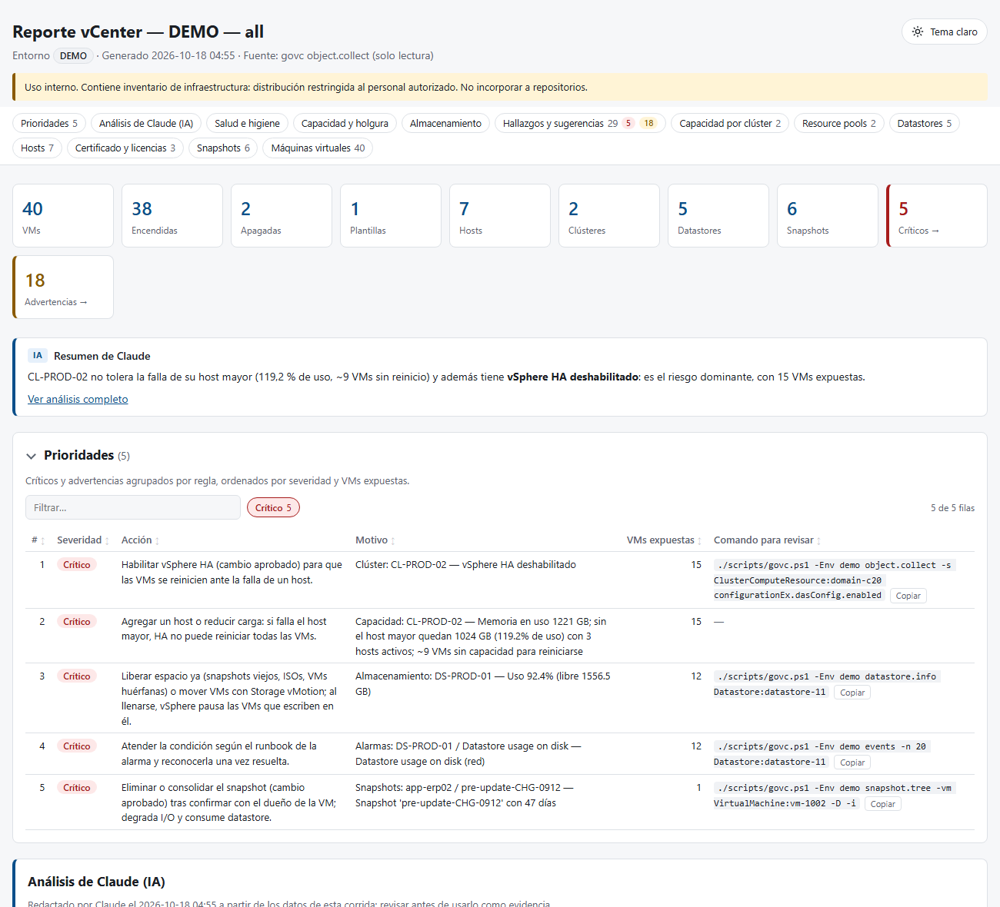

<p align="center">
  <picture>
    <source media="(prefers-color-scheme: dark)" srcset="docs/src/assets/logo-dark.svg">
    
  </picture>
</p>

<h1 align="center">Plataforma vSphere · govc</h1>

<p align="center">
  <a href="https://galexbh.github.io/vcenter/">Documentación</a> ·
  <a href="#puesta-en-marcha">Puesta en marcha</a> ·
  <a href="#modelo-de-seguridad">Seguridad</a>
</p>

Kit para operar, analizar y auditar VMware vCenter con [`govc`](https://github.com/vmware/govmomi/tree/main/govc) desde Claude Code de forma controlada. Incluye consultas de inventario, reportes HTML y Markdown con hallazgos priorizados, análisis de tendencias, auditorías técnicas formales y provisión de máquinas virtuales con aprobación explícita.

Las credenciales se guardan solo en Windows Credential Manager. Cada operación pasa por un wrapper que aplica la política del entorno y la registra en una bitácora con integridad verificable.

<p align="center">
  <picture>
    <source media="(prefers-color-scheme: dark)" srcset=".github/assets/vista-reporte-oscuro.png">
    
  </picture>
  <br>
  <sub>Reporte generado con <code>task demo</code>; los datos son ficticios.</sub>
</p>

---

## Capacidades

| Área | Descripción |
|---|---|
| Consulta | Inventario completo con un número fijo de consultas en bloque (`object.collect`), sin depender del tamaño del entorno |
| Reportes | Inventario, snapshots, capacidad y salud en HTML, Markdown y CSV, con hallazgos clasificados por severidad |
| Diagnóstico de hosts | Revisión por `esxcli` de cada host de un clúster (VIBs, NIC, paths, NTP, syslog, coredump) y detección de diferencias |
| Auditoría | Informe formal imprimible con resumen ejecutivo, metodología, hallazgos `AUD-NNN`, plan de remediación y aprobación |
| Tendencias | Comparación entre corridas o auditorías sin volver a consultar vCenter |
| Provisión | Creación de VM desde plantilla con el flujo validar → planear → aprobar → ejecutar → verificar |

## Requisitos

| Dependencia | Para qué | Instalación |
|---|---|---|
| Windows 10 u 11 | Windows Credential Manager guarda las credenciales | — |
| [Claude Code](https://claude.com/claude-code) | CLI, aplicación de escritorio o extensión de IDE | — |
| PowerShell 7.5 o superior | Scripts, wrapper y guardas | `winget install --id Microsoft.PowerShell -e` |
| Git for Windows | Clonar el repositorio y ejecutar el control `pre-commit` | `winget install --id Git.Git -e` |
| [Task](https://taskfile.dev) | Atajos de `Taskfile.yml` | `winget install --id Task.Task -e` |
| Node.js LTS (opcional) | Compilar la documentación en local | `winget install --id OpenJS.NodeJS.LTS -e` |

```powershell
winget install --id Microsoft.PowerShell -e
winget install --id Git.Git -e
winget install --id Task.Task -e
```

Abre una terminal nueva después de instalar, para que `pwsh`, `git` y `task` queden en el `PATH`. govc no se instala con winget: lo descarga `task install` con verificación SHA256.

También se necesita una cuenta de servicio de vCenter por entorno, con **rol mínimo**: de preferencia una de solo lectura para reportes y otra con privilegios de provisión limitados a carpetas y pools.

## Puesta en marcha

```powershell
# 1. Clonar y preparar: activa el control pre-commit y crea config/environments.json desde el ejemplo
git clone https://github.com/galexbh/vcenter.git
cd vcenter
task setup

# 2. Ajustar config/environments.json: url, datacenter, mode (readonly | confirm | lab), caCerts…

# 3. Instalar la versión estable más reciente de govc en tools/
task install

# 4. Registrar las credenciales en Windows Credential Manager (pide usuario y contraseña por consola)
task credential ENV=lab
task credential ENV=prod ACCOUNT=svc-govc-ro@vsphere.local

# 5. Verificar guardas y conectividad
task test:guards
task env ENV=lab
```

La contraseña la pide `cmdkey` por consola: no queda en el historial ni en argumentos. La tarea se niega a ejecutarse dentro de Claude Code, porque la credencial siempre la registra una persona.

Después, abre Claude Code en la carpeta del proyecto y usa los comandos de la sección siguiente, o los atajos de Task desde una terminal.

## Comandos de Claude Code

| Comando | Propósito |
|---|---|
| `/env lab` | Verificar perfiles y conectividad |
| `/inventory prod` | Resumen de inventario en pantalla |
| `/report prod health` | Reporte HTML, Markdown o CSV en `reports/` (`all`, `inventory`, `snapshots`, `capacity`, `health`) |
| `/health prod` | Hallazgos priorizados con acciones sugeridas |
| `/capacity prod` | Capacidad por clúster y holgura ante la falla de un host |
| `/snapshot-audit prod 7` | Snapshots por antigüedad y plan de limpieza propuesto (no ejecuta) |
| `/host-check prod CL-PROD-01` | Revisión `esxcli` por host y detección de diferencias |
| `/trend prod` | Tendencias entre las dos últimas corridas |
| `/audit prod` | Auditoría técnica completa con informe formal |
| `/vm-create specs/app01.yaml` | Provisión de una VM con validación y aprobación |

## Atajos con Task

`task` sin argumentos lista todas las tareas.

| Tarea | Ejemplo |
|---|---|
| Registrar, listar o eliminar credenciales | `task credential ENV=lab` · `task credential:list` · `task credential:remove ENV=lab` |
| Probar conexión | `task env ENV=lab` |
| Salud, inventario, capacidad, snapshots | `task health ENV=prod` · `task inventory ENV=prod` · `task capacity ENV=prod` · `task snapshots ENV=prod` |
| Reporte a medida | `task report ENV=prod TYPE=all -- -Format csv` |
| Revisión de hosts | `task host-check ENV=prod CLUSTER=CL-PROD-01` |
| Auditoría | `task audit ENV=prod SCOPE=security` |
| Tendencias | `task trend ENV=prod` |
| Reanalizar sin consultar vCenter | `task health FROM=reports/prod/<marca>` |
| Instalar o actualizar govc | `task install` · `task install -- -Version vX.Y.Z` |
| Documentación | `task docs` · `task docs:build` |

- `ENV` indica el entorno y `FROM`, una carpeta ya recolectada en `reports/`. Los reportes necesitan una de las dos.
- Con `FROM`, el reporte se regenera dentro de la carpeta original y reescribe su `raw/findings.json` y `raw/summary.json`; si cambias umbrales al reanalizar, eso también cambia las comparaciones posteriores de `/trend`.
- Los parámetros adicionales de cada script van después de `--`.
- `task --dry <tarea> …` muestra el comando sin ejecutarlo.
- Las tareas solo cubren operaciones que no modifican vCenter. Los cambios y la provisión siguen el flujo con validación y aprobación (`/vm-create`).

## Modelo de seguridad

| Capa | Función |
|---|---|
| `scripts/govc.ps1` | Único punto de entrada. Lee la credencial de Credential Manager en cada llamada, la expone solo durante la ejecución, no guarda sesiones en disco, aplica el modo del entorno y registra cada acción en `logs/` |
| `.claude/hooks/govc-guard.ps1` | Revisa cada comando de Claude antes de ejecutarlo. Bloquea el uso directo de govc, el manejo de secretos, las operaciones destructivas fuera de `lab` y las escrituras en `readonly`. Pide aprobación para escrituras y aprueba de forma automática solo las lecturas |
| `.claude/hooks/read-guard.sh` | Revisa las lecturas de Claude (Read, Glob, Grep) y bloquea el acceso a la carpeta de sesión temporal del modo por lotes y a las sesiones de `~/.govmomi` |
| `.claude/settings.json` | Impide a Claude editar guardas, bitácoras y configuración, y leer `~/.govmomi`. Pide aprobación antes de editar `config/environments.json` |
| `.gitignore` y `.githooks/pre-commit` | `reports/`, `logs/`, `config/environments.json`, `tools/` y `specs/` no se versionan nunca. Además, se escanea el diff en busca de credenciales |

**Modos de entorno**

| Modo | Lectura | Escritura | Operaciones destructivas |
|---|---|---|---|
| `readonly` | Libre | Bloqueada | Bloqueadas |
| `confirm` | Libre | Con aprobación | Solo una persona, en terminal interactiva |
| `lab` | Libre | Con aprobación | Con aprobación |

En `prod` y `dr`, las operaciones destructivas solo las ejecuta una persona en una terminal interactiva, escribiendo el nombre del entorno para confirmar y con un número de cambio aprobado.

## Pruebas

```powershell
task test          # guardas (clasificación y hook) y regresión de reportes, CSV, hosts, auditoría y tendencias
task test:log      # integridad de la bitácora
```

### Sin vCenter real

- **Datos de demostración:** `task demo` crea un entorno ficticio en `reports/demo/<marca>-auditoria`, con el reporte de inventario, la revisión de hosts y la auditoría. Para generar otros reportes sobre esos datos: `task health FROM=reports/demo/<marca>-auditoria/inventario`.
- **Simulador:**

  ```powershell
  task install -- -WithVcsim
  task vcsim                                 # credenciales por defecto del simulador: user / pass
  ```

  Agrega un perfil `vcsim` (`url: https://127.0.0.1:8989/sdk`, `insecure: true`, `mode: lab`) y registra su credencial con `task credential ENV=vcsim ACCOUNT=user`.

## Estructura del proyecto

```text
.claude/        Skills, comandos, hooks de control y permisos de Claude Code
.githooks/      Control pre-commit
.github/        Workflow de publicación de la documentación y recursos del README
config/         Perfiles de entorno (solo se versiona el ejemplo)
docs/           Documentación (Astro Starlight), publicada en GitHub Pages
scripts/        Wrapper, reportes, auditoría, pruebas y módulos (scripts/lib/)
specs/          Especificaciones de VM propias (no versionadas)
templates/      Plantillas de reporte, de auditoría y de especificación de VM
tools/          govc y vcsim instalados por task install (no versionados)
CLAUDE.md       Reglas del proyecto para Claude Code
Taskfile.yml    Atajos de Task para reportes, pruebas, instalación y documentación
.gitattributes  Finales de línea por tipo de archivo
reports/ logs/  Salidas locales: reportes y bitácora (no versionadas)
```

## Documentación

El sitio se publica en https://galexbh.github.io/vcenter/. Cada cambio en `docs/` que llega a `main` lo compila y despliega el workflow `.github/workflows/docs.yml`.

Para trabajar en local: `task docs` (servidor en http://localhost:4321/vcenter/) o `task docs:build` (sitio estático en `docs/dist/`).

## Consideraciones

- Los reportes y la bitácora contienen inventario interno. Se quedan en `reports/` y `logs/`, y no deben publicarse en otros sistemas sin la validación de Seguridad de la Información.
- Los cambios en `prod` o `dr` necesitan un número de cambio aprobado y la validación del equipo dueño (Infraestructura o Seguridad).
- Las auditorías son técnicas y no constituyen una certificación de cumplimiento normativo. Sus resultados deben validarlos Auditoría Interna, Riesgo Tecnológico y Seguridad de la Información.
